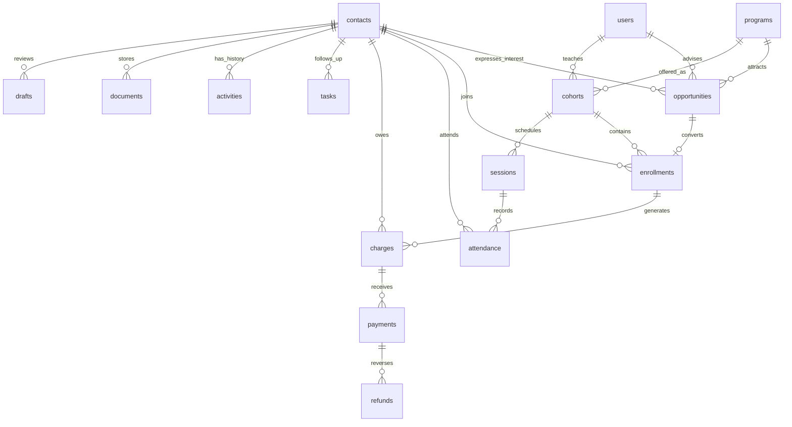

# Product blueprint and architecture

## Product shape

One staff workspace connects inquiries, people, learning groups, and payment records. A person exists once; separate opportunities and enrollments track their interest in different programs. The overview prioritizes actions staff need to take today. Detailed records open in a drawer so the admissions filter and scroll position remain intact.

The provisional visual system uses warm off-white surfaces, deep navy text, muted teal primary actions, and restrained category colors. DM Sans and Noto Sans Arabic are bundled with the build. Layouts use logical CSS properties so the Arabic workspace mirrors correctly. Branding is provisional, not an invented official logo.

## Components

| Layer              | Responsibility                                                                |
| ------------------ | ----------------------------------------------------------------------------- |
| React + TypeScript | Shell, navigation, dialogs, tables, forms, profiles, bilingual controls       |
| Vite               | Development middleware and production asset build                             |
| Express            | Authentication, scoped reads, validation, transactions, exports and downloads |
| Node `node:sqlite` | File-backed relational storage; no browser-local CRM records                  |

`src/App.tsx` owns the session, shared state and overlays. `pages.tsx` contains operational views; `profile.tsx` contains the student/contact drawer; `forms.tsx` contains validated workflow forms. `ui.tsx` provides reusable accessible controls. `server/index.mjs` defines the API and authorization; `server/db.mjs` handles migrations, demo seeding and shared database helpers.

## Relational model

Additional tables hold waitlists, hashed authentication sessions, workspace settings, user-owned saved views, resolved attention flags, automation executions, request idempotency keys, and schema migration versions. Foreign keys and an active-enrollment uniqueness index prevent orphan records and duplicate enrollment in the same cohort.

## Access matrix

| Capability                     | Admin   | Admissions | Academic              | Instructor          | Finance | Manager  |
| ------------------------------ | ------- | ---------- | --------------------- | ------------------- | ------- | -------- |
| Contacts                       | Full    | Full       | Full                  | Assigned students   | Read    | Read     |
| Admissions                     | Edit    | Edit       | API enrollment action | None                | None    | Read     |
| Programs/cohorts               | Edit    | Read       | Edit                  | Assigned cohorts    | Read    | Read     |
| Sessions/attendance            | Edit    | Read       | Edit                  | Assigned attendance | Read    | Read     |
| Charges/payments/refunds       | Edit    | None       | None                  | None                | Edit    | Read     |
| Tasks                          | All     | Own        | Own                   | Own                 | Own     | Read all |
| General notes                  | Write   | Write      | Write                 | Assigned contacts   | Write   | Read     |
| Admissions-only notes          | Write   | Write      | None                  | None                | None    | Read     |
| Finance-only notes             | Write   | None       | None                  | None                | Write   | Read     |
| Settings and role assignment   | Edit    | Read       | Read                  | Scoped read         | Read    | Read     |
| Integration checks/rule runner | Execute | No         | No                    | No                  | No      | No       |

Every API request resolves the role from the server-side session and current user record. The client never supplies authoritative roles. Instructor exports and document downloads use the same contact scope. Changing a role revokes that account's sessions. The final administrator cannot be demoted; instructors and advisors must have assignments removed before losing their relevant role.

## Data integrity and metric definitions

- Write operations run inside `BEGIN IMMEDIATE` transactions. Idempotency keys are bound to user, route, method and payload, and return the first successful result on retry.
- Opportunity and task updates require the current version number. Stale edits receive HTTP 409 rather than silently replacing newer changes. Other forms validate against current database state inside a transaction.
- Enrollment checks capacity transactionally, reuses the contact, creates the enrollment and charge, transitions the opportunity, and creates an onboarding task as one operation. A full cohort only adds a waitlist record when explicitly selected.
- Amounts use integer hundredths of currency units. Outstanding balance is charge minus discount minus payments plus refunds. Overpayments and over-refunds are rejected. Installment division assigns the remainder to the final installment so totals remain exact.
- Program-price edits apply to future charges. Existing charges retain their original values and currency. Transfers retain previous enrollment and charge history.
- New leads counts opportunities created within the selected period, including ones later enrolled. Conversion is the percentage of that same opportunity cohort currently enrolled. It is not enrollments in the period divided by unrelated leads in that period.
- Confirmed enrollments counts original opportunity-backed enrollment records created within the period, excluding transfer-generated records. Payments received is payments dated within the period minus refunds dated within it, by currency. Outstanding is all unpaid charges regardless of period.
- Attendance rate is present plus late divided by recorded attendance excluding excused absences. Unmarked attendance is not assumed present.
- Two recorded absences produce an attention flag. Reviewing a flag stores its triggering record fingerprint, so new evidence can raise it again.

## Security and operational limits

The app is deliberately bound to loopback for local demo use. Passwords are salted with scrypt. Session cookies are HttpOnly and SameSite Strict with a 12-hour lifetime. Server logs avoid credentials. External-origin writes and unexpected Host values are rejected. SQL values use bound parameters. File downloads are attachments; uploads are restricted to four document types and 4 MB. CSV cells that could be interpreted as formulas are prefixed.

The Vercel version uses Secure cookies and a sensitive environment variable for its initial administrator password. Login attempts are stored in SQLite so the limit survives function instances. Cloud requests use AsyncLocalStorage to isolate their SQLite connections, then commit private Blob snapshots with ETag preconditions. Successful responses and cookies are not sent until persistence succeeds. Failed preconditions discard the temporary connection and return 409. An unavailable store returns 503 rather than a false success.

This release has not received an independent production security assessment. Operational use needs staff provisioning, password recovery, backups/restore, malware scanning as appropriate, and provider-specific webhook verification. The snapshot adapter targets small datasets, with a 64 MB limit; managed SQL is the next step for larger deployments. External messaging and payment services are not connected.
